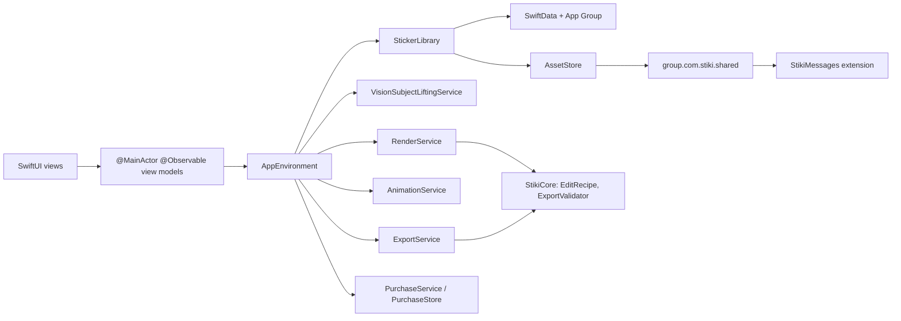

# Stiki

An iOS sticker maker for iPhone and iPad. Cut a subject out of a photo on the device, keep the original so you can re-edit later (including inside a pack), and export one pack to iMessage, WhatsApp and Telegram.

Stiki is built against the iOS 26 Liquid Glass APIs. There is no account, no tracker, no weekly subscription and no watermark.

## Differentiators

1. Native Liquid Glass UI — floating glass toolbars, morphing editor palette.
2. On-device Vision subject lifting, multi-subject selection and brush refinement.
3. Animated stickers from Live Photos and short videos, compressed to messenger limits.
4. Export validator with per-target readiness badges and one-tap auto-fit.
5. Non-destructive editing: every sticker stores its source and `EditRecipe`.
6. One pack → iMessage, WhatsApp and Telegram.
7. Fair pricing: generous free tier, Pro as a one-time purchase or yearly. No weekly plan.
8. Privacy-first: App Privacy “Data Not Collected”, local storage, optional iCloud for Pro.

App Store listing copy, review notes, and a submission checklist live in [`docs/appstore/`](docs/appstore/README.md). Public privacy, terms, and support pages are GitHub Pages-ready in [`docs/`](docs/index.html). Screenshots: run `scripts/capture-screenshots.sh` on a Mac (see [`docs/appstore/SCREENSHOT_PLAN.md`](docs/appstore/SCREENSHOT_PLAN.md)).

## Requirements

| Tool | Version |
|---|---|
| Xcode | **26.0** or later (iOS 26 SDK) |
| Swift language mode | **6.0** (`SWIFT_VERSION` / `.swiftLanguageMode(.v6)`) |
| Deployment target | **iOS 26.0** (iPhone + iPad) |
| macOS | **26** (to run Xcode 26) |
| [XcodeGen](https://github.com/yonaskolb/XcodeGen) | **2.42.0** or later (`brew install xcodegen`) |

This repository does **not** contain an `.xcodeproj`. Generate it on a Mac.

## Build on a Mac

```bash
brew install xcodegen
cd /path/to/stiki
xcodegen generate
open Stiki.xcodeproj
```

Or from the command line:

```bash
xcodegen generate
xcodebuild \
  -scheme Stiki \
  -destination 'platform=iOS Simulator,name=iPhone 17' \
  -configuration Debug \
  build test
```

If `iPhone 17` is not installed, list destinations with `xcodebuild -scheme Stiki -showdestinations` and substitute a simulator that is.

The `Stiki` scheme runs `StikiTests` and `StikiUITests` and attaches `Configuration.storekit` for local StoreKit. That file is **not** copied into the Release app bundle.

### Archive for App Store Connect (Mac + paid Apple Developer account)

```bash
export TEAM_ID=YOUR_10_CHAR_TEAM_ID
./scripts/archive-app-store.sh
```

Details, export options, and upload notes: [`docs/appstore/ARCHIVE.md`](docs/appstore/ARCHIVE.md).

Legal URLs default to `https://gabrielfrey.github.io/Stiki/` (privacy / terms / support). Enable GitHub Pages from the `docs/` folder or change `App/Support/LegalLinks.swift`.

### StikiCore on any Swift 6.2 host (including Linux)

The domain layer has no UIKit / SwiftUI dependency:

```bash
cd Packages/StikiCore
swift test
```

On this Linux cloud agent that command passed **72 tests in 9 suites** with Swift 6.2.

## Signing and App Groups

In Xcode, select the `Stiki` and `StikiMessages` targets and set your Development Team.

Create (or let Xcode create) these identifiers on the Apple Developer portal:

| Kind | Value |
|---|---|
| App bundle ID | `com.stiki.app` |
| Messages extension | `com.stiki.app.messages` |
| App Group | `group.com.stiki.shared` |
| iCloud container (optional, Pro sync) | `iCloud.com.stiki.app` |

Both targets already declare the App Group in entitlements generated from `project.yml`. If the group is missing from the provisioning profile, Stiki still launches against the app sandbox; Settings then warns that the iMessage extension cannot see stickers.

## StoreKit testing

`Configuration.storekit` defines:

| Product | Type | Price (StoreKit config) |
|---|---|---|
| `com.stiki.pro.lifetime` | Non-consumable | $9.99 |
| `com.stiki.pro.yearly` | Auto-renewable, 1 year | $4.99 |

There is **no weekly product** and **no introductory offer**. Attach the configuration via the scheme (already wired) or Product → Scheme → Run → Options → StoreKit Configuration.

Free tier: unlimited static stickers, 3 packs, all export destinations, no ads, no watermark.

Pro: unlimited packs, animated stickers, glow/puffy outlines, comic/posterize/glossy filters, optional iCloud sync.

## Export limits

| Target | Canvas | Static | Animated | Pack | Other |
|---|---|---|---|---|---|
| WhatsApp | 512×512 | WebP ≤ 100 KB | WebP ≤ 500 KB, frames ≥ 8 ms, ≤ 10 s | 3–30 stickers, 1–3 emoji each | Tray 96×96 PNG ≤ 50 KB |
| Telegram | 512 px longest side | WebP/PNG ≤ 512 KB | WebM ≤ 256 KB ≤ 3 s | 1–120 | Animated WebM is **not encoded on device** in this build; Stiki ships GIF and documents the limitation |
| iMessage | 300 / 408 / 618 pt | PNG ≤ 500 KB | APNG/GIF ≤ 500 KB | 1+ | App Group catalog + `MSStickerBrowserViewController` |
| Photos & Files | ≤ 2048 px | PNG | GIF/APNG | — | Share sheet, clipboard, save to Photos |

WhatsApp hand-off writes pasteboard type `net.whatsapp.third-party.sticker-pack` and opens `whatsapp://stickerPack` (`whatsapp` is in `LSApplicationQueriesSchemes`).

## Architecture



`StikiCore` is a local Swift package. It holds recipes, messenger limits, validation and layout math so those rules can be tested on Linux. The app target owns Vision, CoreImage, AVFoundation, StoreKit and SwiftUI.

## Project layout

```
project.yml                 # XcodeGen
Configuration.storekit      # Debug / tests only
Config/exportOptions.plist  # App Store export template
Packages/StikiCore/         # domain + swift test
App/                        # SwiftUI app
MessagesExtension/          # iMessage sticker browser
Tests/StikiTests/
Tests/StikiUITests/
docs/                       # spec, Pages legal site, appstore/
scripts/                    # icons, screenshots, archive
```

## Roadmap (v1.1)

- Image Playground / Apple Intelligence stickers
- Genmoji-style creation
- Home Screen widgets
- Mac Catalyst

## License

MIT. See `LICENSE`.
